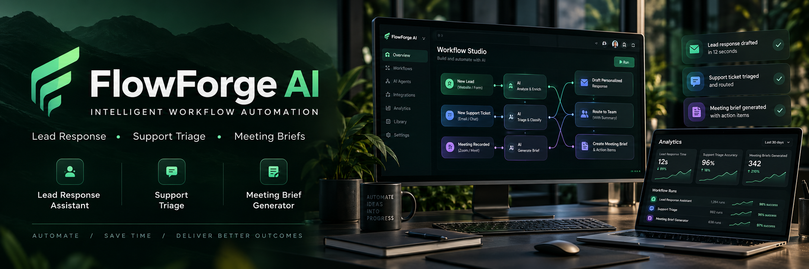

# FlowForge AI — Business Automation Studio

A GitHub-ready AI automation business prototype featuring a professional public marketing website and a private, functional workflow studio. Built with **FastAPI, Jinja2, SQLite, and Docker**.

## What works

- Public, responsive company website at `/`
- Password-protected automation studio at `/studio` (HTTP Basic Auth)
- Three starter workflows: **Lead Reply Assistant**, **Support Triage**, and **Meeting Brief Generator**
- Create workflows; enable/disable them; run sample customer requests
- Draft generation with a **no-key, deterministic demo mode**, plus optional OpenAI Responses API integration
- Saved workflow configurations and execution history in a persistent SQLite Docker volume
- Health check at `/health`; Docker Compose binds to **127.0.0.1:8130** so the admin interface is not publicly exposed

**Important:** The generated content is a **draft for human review**. The product does **not** send emails, take actions on customer systems, or autonomously execute integrations. Workflow `instructions` are stored as metadata for future customization; demo/OpenAI generation uses the selected workflow category, not these freeform notes.

## Run on Ubuntu / yeet

```bash
cp .env.example .env
nano .env   # Set a strong unique ADMIN_PASSWORD
# Start
docker compose up -d --build
docker compose ps
curl http://127.0.0.1:8130/health
```

From a Fedora desktop, tunnel to the server:

```bash
ssh -o ExitOnForwardFailure=yes -N -L 8130:127.0.0.1:8130 yeet
```

Open `http://localhost:8130` for the website or `http://localhost:8130/studio` for the admin studio. HTTP Basic Auth username: `admin`, password: your `.env` password.

## Optional real AI generation

Set `AI_MODE=openai` and supply `OPENAI_API_KEY` in `.env`, then `docker compose up -d --force-recreate`. Provider use is billable and sends the text supplied in the studio form to the API. Do not enter sensitive customer information without proper consent, agreements, and safeguards. `OPENAI_MODEL` is configurable; the default model may change or become unavailable. A paid API key is not required for demo mode.

## GitHub publication

Commit source code, templates, example configuration, and docs—but **never `.env`, tokens, or the database**. The default setup is a local prototype, not a production-ready multi-tenant SaaS product.

```bash
git init && git branch -M main
git add . && git status --short
git commit -m "Launch FlowForge AI automation studio"
gh repo create flowforge-ai-business --private --source=. --remote=origin --push
```

## Roadmap

1. Stronger authentication (individual users, session controls, CSRF protection, rate limiting)
2. Human approvals, editable generated drafts, and audit logs
3. Workflow execution engine with safe integration sandbox
4. Secure customer onboarding, consent and retention policies
5. Billing integration with webhooks and subscription lifecycle
6. Production HTTPS, monitoring, backups, and vulnerability review

See `docs/BUSINESS_PLAN.md` and `docs/LAUNCH_CHECKLIST.md`.
